<p align="center">
  
</p>

<p align="center">
  <b>Native Rust AV2 encoder workbench.</b><br>
  Slint UI. Local processing.
</p>

A native desktop workbench for encoding video to AV2, built on the
[Splot](https://github.com/splotlabs/splot) codec. Rust and [Slint](https://slint.dev), for
Windows, macOS and Linux. Processing is local; there is no web or browser target.

## Status

Version 0.1.0, unsigned test builds only; nothing is released yet. Encoding is slow: the
codec is young.

**What it does**

- Converts ordinary local video files (MP4, MOV, MKV, WebM, MPEG-TS, AVI) and Y4M to
  video-only AV2, as IVF or an Annex B `.obu` stream. 8-bit and 10-bit SDR.
- One compact window: pick Quality and Priority, press Convert, watch real progress, cancel.
  Several files queue up, and the list survives restarts and crashes.
- Preview: the real encoded picture while converting, press and hold to compare with the
  original, scrubbing and playback of source and result.
- Every result is verified, then published without ever replacing an existing file. Source
  files are never modified.

**What it refuses, with a reason**

Variable frame rate, interlaced, HDR (PQ, HLG, Dolby Vision), full range, non-square pixels,
rotation or cropping, RGB or alpha, encrypted streams, network and playlist inputs.

**What it does not do yet**

- Audio, subtitles and chapters are not carried over; the app lists what a file would lose
  and asks before converting. Container output with audio is planned in
  [#12](https://github.com/splotlabs/splot-studio/issues/12).
- No resize, target size, pause or background conversion: closing the window stops the
  current file.
- Packages are unsigned and need an x86-64-v3 processor (AVX2) on Windows and Linux.

Known defects are in the [issues](https://github.com/splotlabs/splot-studio/issues); what
stands between the test builds and a real release is in
[`docs/release/CHECKLIST.md`](docs/release/CHECKLIST.md).

**Crates**

- `studio-app` (`splot-studio`): the Slint desktop app.
- `studio-engine` (`splot-studio-engine`): the headless engine. `worker` runs one job per
  process over a versioned, length-prefixed control protocol, `preview` serves pictures, and
  `encode` runs the same job from the command line.
- `studio-domain`: shared settings, job and protocol values (no GUI, codec or native types).

## Development

Rust is pinned by `rust-toolchain.toml` (1.100.0); rustup installs it on first use. On Linux the
GUI build needs `pkg-config` and the fontconfig development files (`libfontconfig-dev` on
Debian/Ubuntu). Reading files other than Y4M, and the test suite, need `ffmpeg` and `ffprobe`
on `PATH` during development; packages ship their own LGPL build instead (see
`native/ffmpeg/README.md`).

```sh
cargo xtask doctor                 # toolchain and native prerequisites; read-only
cargo xtask ci --fast              # fmt, repo checks, clippy, unit tests
cargo xtask ci                     # full gate, as CI runs it
cargo xtask run --release          # the desktop app, with its engine built to match
cargo run -p studio-engine -- --help
cargo run --release -p studio-engine -- encode in.y4m out.ivf
cargo xtask package --smoke        # unsigned test package for this OS in target/package/
```

`cargo xtask package` needs the FFmpeg pair from `native/ffmpeg/build.sh <target>`; it builds
the app for plain x86-64 and the engine for x86-64-v3 (the app refuses older processors
before starting it), writes `BUILD.json` and the notices, and archives a `.tar.gz` (Linux) or
`.zip` (Windows, and macOS with a `.app` bundle). `cargo xtask smoke` unpacks it and runs it
with an emptied environment. Packages are unsigned test builds; see `docs/release/`.

`cargo run -p studio-app` rebuilds only the app, not the engine it starts; use `cargo xtask run`.

Rules for contributors and coding agents are in [`AGENTS.md`](AGENTS.md).

## Licence

Source-available, not open source. Original project material is licensed under the
[PolyForm Noncommercial License 1.0.0](LICENSE.md). Uses outside that licence, which includes
typical commercial deployments, need a separate written licence from Bartosz Tomczyk
(bartekplus@gmail.com). SplotLabs and splot are project names he uses, not a separate company.
Third-party components keep their own licences, see
[`THIRD-PARTY-NOTICES.md`](THIRD-PARTY-NOTICES.md); a commercial licence for Splot Studio does
not cover them. Splot Studio uses Slint under the Slint Royalty-free License 2.0. How
contributions to Splot Studio are licensed does not change that, or the licence of FFmpeg or any
other dependency.

## Contributing

Read the [contribution policy](https://github.com/splotlabs/.github/blob/main/CONTRIBUTING.md)
first. Other people's contributions are licensed by their authors under the unmodified MIT No
Attribution License (MIT-0), through the
[SplotLabs Contribution Terms](https://github.com/splotlabs/.github/blob/main/CLA.md). You keep
your copyright. MIT-0 lets everyone who receives your contribution reuse it, including
commercially. It covers only your own original material. The rest of Splot Studio, including the
file you edit, keeps its licence.

A contribution is merged only after each rights holder's acceptance of the approved terms is
recorded. This link, a ticked box in a pull request and a green CI run are not that acceptance.
